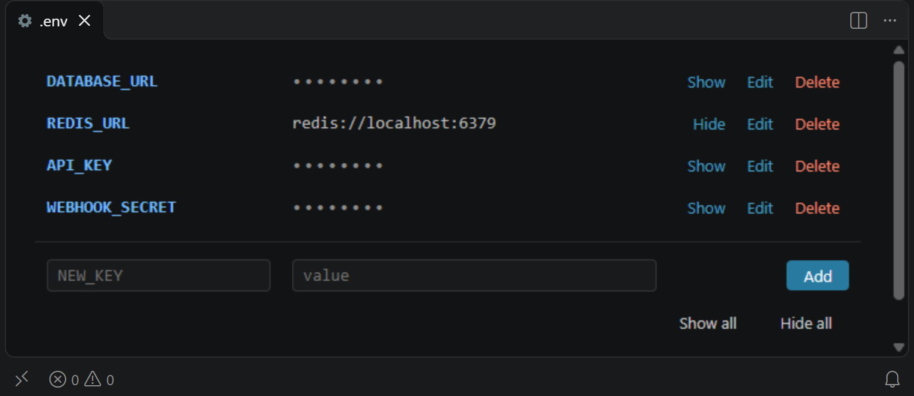

# Env editor

Hides the values of your `.env` files (`.env`, `*.env`, `.env.*`) while you edit them as plain text.

- **Show / Hide** above each variable reveals or hides its value.
- **Show all / Hide all** in the status bar does the same for the whole file.

Values are hidden whenever a file is opened, including commented-out variables (`# KEY=value`), and hidden again when you close it.

Only the editor display is masked and the file is never modified. Values can still show up briefly while VS Code starts or on the extra lines of multiline values, under a block cursor, and in other views such as search results or diffs.

